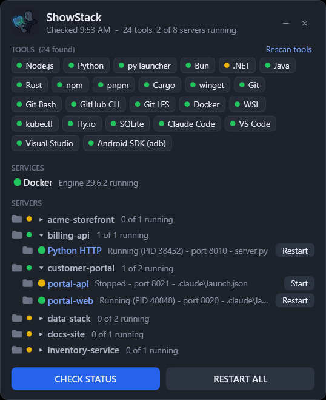

# ShowStack for Linux Mint

The same widget as the Windows version, written for Linux: plain Python 3 and GTK 3, which Linux Mint ships with
(Cinnamon, MATE and Xfce editions alike). No packages to add, no root rights, no internet.

<p align="center">
  
</p>

## Install

1. Download this repository (**Code > Download ZIP**) and extract it anywhere, or `git clone` it.
2. Run:
   ```bash
   bash linux/install.sh
   ```
   Add `--startup` to also open ShowStack when you sign in.
3. Open **ShowStack** from the menu, or double-click it on the desktop (Mint may ask you once to allow launching it).

To run it without installing anything:

```bash
python3 linux/showstack.py
```

The first start looks for tools and servers (about 10 seconds). After that ShowStack opens straight onto its saved
tool list and only checks servers.

## What is different from the Windows version

Everything you see works the same: the tool boxes, Docker, the servers found in your project code with their green,
yellow and red lights, Start / Restart / Install, folding sections, the All | Running switch, the copy icon that puts
the whole stack on the clipboard as Markdown, hiding servers, and opening folders. Under the hood:

| | Windows | Linux Mint |
|---|---|---|
| Runs on | Windows PowerShell 5.1 + WPF | Python 3 + GTK 3 (PyGObject) |
| Tool catalog | `tool-catalog.json` (winget, `%ProgramFiles%` paths) | `linux/tool-catalog.json` (apt, Flatpak, `~/.local/bin`, `~/.cargo/bin`...) |
| Installing a tool | winget or the vendor installer, in a PowerShell window | `sudo apt install`, Flatpak or the vendor installer, in your terminal |
| Settings | `showstack.json` next to the app | `~/.config/showstack/showstack.json` |
| Saved state and logs | `%LOCALAPPDATA%\ShowStack` | `~/.local/state/showstack` |
| Docker | Starts Docker Desktop | Starts the Docker service (asks for your password), rootless Docker or Docker Desktop for Linux, whichever you have; tells you when your user is not in the `docker` group |
| Folder icon | File Explorer | Your file manager (Nemo, Caja, Thunar...) |
| Second launch | Ignored | Brings the open widget to the front |

The widget reads the `PATH` of your interactive shell (so Node from nvm, Rust from rustup and anything your `.bashrc`
adds are found even though a desktop launcher does not run `.bashrc`) and also looks in the usual places tools
install themselves: `~/.local/bin`, `~/.cargo/bin`, `~/.bun/bin`, `~/.deno/bin`, `~/go/bin`, `/snap/bin`, Flatpak
exports and Homebrew.

Servers it starts run in their own session with their output in `~/.local/state/showstack/*.log`, so closing the
widget does not stop them, and Restart ends the whole process tree it started.

## Settings

`~/.config/showstack/showstack.json` is created on first run. The ones you are most likely to change:

```json
{
  "requiredTools": ["Git", "Node.js", "Python"],
  "projectRoots": ["~/source/repos", "~/repos", "~/dev", "~/code", "~/projects", "~/src", "~/Documents/GitHub"],
  "includeClaudeProjects": true,
  "excludeFolders": ["*backup*", "*archive*"]
}
```

`~` and `$HOME`-style variables work in paths. Every other setting (`scanDepth`, `shellFolder`, `titles`, `ports`,
`tools`) means the same as in the [Wiki](../../../wiki/Settings). To add a tool of your own, or change how one is
found or installed, put an entry in `tools` with the same fields as `linux/tool-catalog.json`; it overrides the
catalog entry with the same name.

## Checking without the window

```bash
python3 linux/showstack-report.py
```

prints the tools and servers ShowStack would show after a fresh scan.

## Requirements

Linux Mint 20 or later (or any distribution with Python 3.8+ and GTK 3). If `python3 linux/showstack.py` complains
about `gi` or `Gtk`, install the bindings, which Mint has by default:

```bash
sudo apt install python3-gi gir1.2-gtk-3.0
```

Rounded corners need a compositing window manager (Cinnamon, Xfce's and MATE's compositors are on by default);
without one the window is square. Remembering the window position needs X11, which Mint uses.
